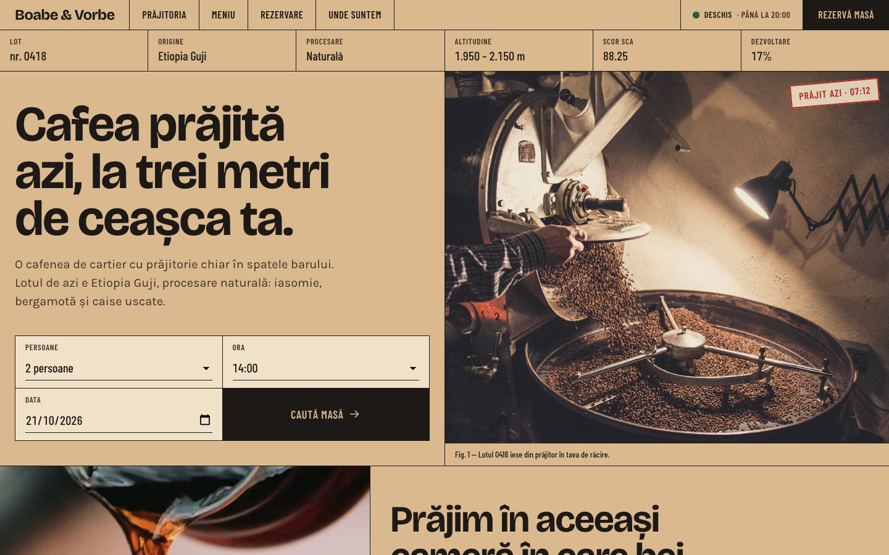
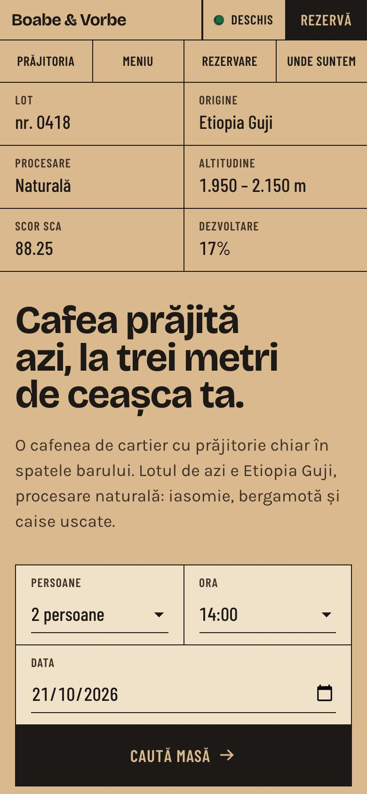
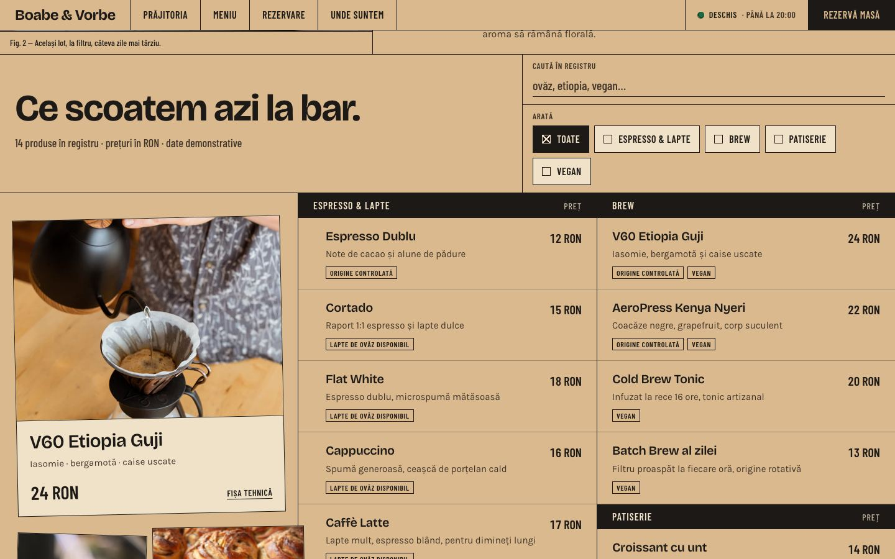
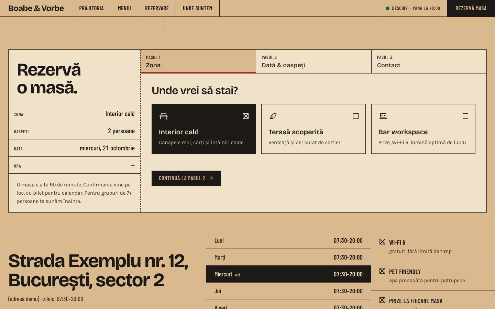

# Boabe & Vorbe



Site pentru o cafenea cu prăjitorie proprie și rezervări (Astro).

> Proiect demonstrativ. Firma, adresa, telefoanele, emailurile și recenziile sunt fictive. Orice asemănare cu o firmă reală este întâmplătoare.

## Capturi de ecran

| Prima pagină, telefon | Meniul | Rezervare |
|---|---|---|
|  |  |  |

## Tehnologii

Astro, Tailwind CSS 4 și TypeScript, cu Supabase pentru rezervări.

## Decizii tehnice

- Rezervarea e un asistent în trei pași (zonă, dată și ora, contact), cu validare la fiecare pas.
- Rezervările se salvează în Supabase. Politicile RLS din `supabase/migrations` permit vizitatorilor doar să insereze, nu să citească rezervările altora.
- Fonturile sunt găzduite local prin Fontsource.
- Fotografiile sunt de pe Unsplash, cu licența lor, iar autorii sunt trecuți în subsol.
- Accesibilitate: link „Sari la conținut”, mesaje anunțate cititoarelor de ecran (aria-live), focus vizibil la navigarea cu tastatura.
- Animațiile se reduc sau se opresc pentru cine a setat „reducerea mișcării” în sistem (`prefers-reduced-motion`).
- Imaginile din afara ecranului se încarcă abia când e nevoie de ele (`loading="lazy"`).

## Rulare

```bash
npm install
npm run dev
```

## Cum a fost realizat

Proiectul a fost conceput și dezvoltat de Cristian Lucaci. În procesul de creație am folosit și instrumente de inteligență artificială, ca sprijin la scrierea codului, la texte și la verificări. Deciziile de design, alegerile tehnice și forma finală îmi aparțin.

## Licență

Codul este publicat sub licența [MIT](LICENSE), © 2026 Cristian Lucaci.

Resursele terțe incluse (fonturi, biblioteci, fotografii sau modele 3D cu licență liberă) își păstrează licențele proprii, menționate lângă fișiere sau în pagină. Imaginile fără sursă menționată sunt grafică generată pentru acest proiect.
